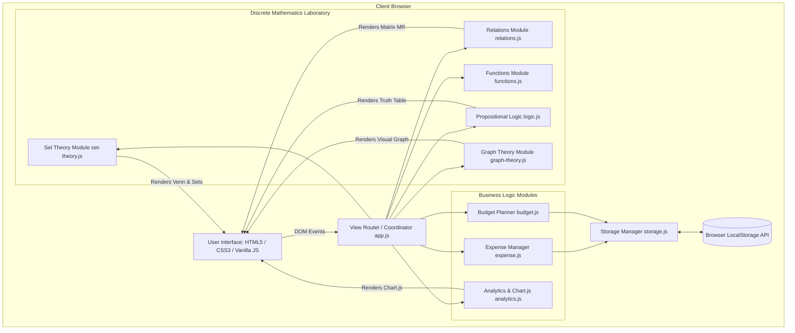
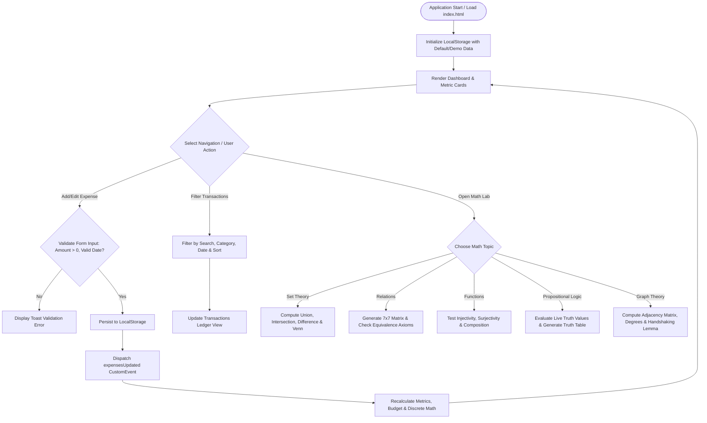
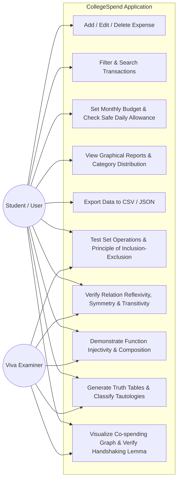
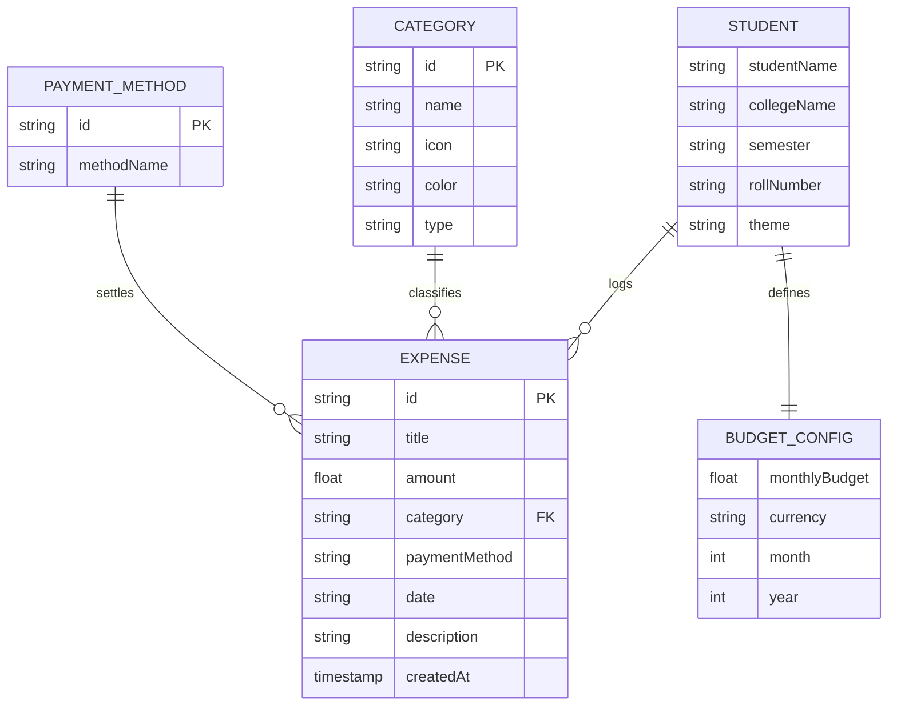
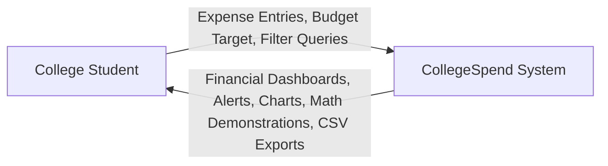
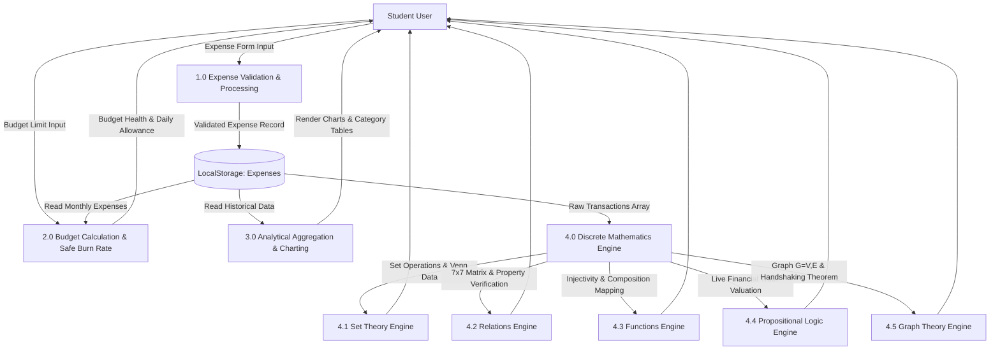

# Academic Project Report & Documentation
## CollegeSpend – Smart College Daily Expense Tracker
### B.Tech 3rd Semester Discrete Mathematics Project

---

| **Item** | **Description** |
| :--- | :--- |
| **Project Title** | CollegeSpend – Smart College Daily Expense Tracker |
| **Academic Level** | B.Tech 3rd Semester |
| **Course & Department** | B.Tech Computer Science and Engineering (CSE) |
| **Course Code & Title** | CS302 / MA301: Discrete Mathematics & Graph Theory |
| **Author / Candidate** | Editable Student Profile (Configured in Profile Settings) |
| **Supervisor / Guide** | Faculty of Computer Science & Mathematics |
| **Institution / University** | Manav Rachna University |
| **Academic Session** | 2026 – 2027 |

---

## Table of Contents
1. [Abstract](#1-abstract)
2. [Introduction](#2-introduction)
3. [Problem Statement](#3-problem-statement)
4. [Objectives](#4-objectives)
5. [Existing and Proposed System](#5-existing-and-proposed-system)
6. [Hardware and Software Requirements](#6-hardware-and-software-requirements)
7. [System Architecture](#7-system-architecture)
8. [System Flowchart](#8-system-flowchart)
9. [Use Case Diagram](#9-use-case-diagram)
10. [Entity-Relationship (ER) & Data Model](#10-entity-relationship-er--data-model)
11. [Data Flow Diagrams (DFD Level 0 & Level 1)](#11-data-flow-diagrams-dfd-level-0--level-1)
12. [Discrete Mathematics Concepts & Implementation](#12-discrete-mathematics-concepts--implementation)
    - 12.1 Set Theory & Principle of Inclusion-Exclusion
    - 12.2 Binary Relations & Equivalence Properties
    - 12.3 Functions, Injectivity & Composition
    - 12.4 Propositional Logic & Truth Table Evaluation
    - 12.5 Graph Theory & Handshaking Lemma
13. [Algorithms](#13-algorithms)
14. [Testing and Results](#14-testing-and-results)
15. [Viva Voce Questions & Answers](#15-viva-voce-questions--answers)
16. [Conclusion & Future Scope](#16-conclusion--future-scope)
17. [References](#17-references)

---

## 1. Abstract
Personal financial management is a critical yet challenging aspect of collegiate life. Undergraduate students frequently struggle with budgeting, unplanned spending on canteen meals, hostel living costs, academic textbooks, and entertainment. While numerous commercial financial tools exist, they are laden with intrusive advertisements, require third-party bank linking, and offer no conceptual educational value.

**CollegeSpend** is a web-based, client-side daily financial tracking system engineered to bridge real-world student financial management with theoretical computer science principles taught in **Discrete Mathematics (B.Tech 3rd Semester)**. The system implements a lightweight, responsive dashboard built using HTML5, CSS3, JavaScript (ES6+), LocalStorage, and Chart.js.

Crucially, **five fundamental Discrete Mathematics pillars are genuinely implemented in functional JavaScript code**:
1. **Set Theory:** Modeling category universes, calculating Union ($A \cup B$), Intersection ($A \cap B$), Difference ($A \setminus B$), Symmetric Difference ($A \Delta B$), and dynamically validating the Principle of Inclusion-Exclusion with an interactive Venn diagram.
2. **Relations:** Constructing binary mapping matrices $M_R \in \{0, 1\}^{7 \times 7}$ for category co-occurrence, evaluating Reflexive, Symmetric, and Transitive axioms, and demonstrating equivalence partitioning.
3. **Functions:** Formalizing expense-to-category and expense-to-cost functions $f: E \to C$, evaluating injectivity via the Pigeonhole Principle, testing surjectivity, and computing composite cost-residue functions $(h \circ g \circ f)(x)$.
4. **Propositional Logic:** Mapping real-time financial thresholds into atomic boolean propositions ($P, Q, R, S$), generating dynamic $2^n$-row truth tables, and classifying compound statements into Tautologies, Contradictions, and Contingencies.
5. **Graph Theory:** Formulating an undirected weighted graph $G = (V, E)$ of expense categories, computing Adjacency Matrices and vertex degrees $\deg(v)$, rendering an interactive HTML5 Canvas visualization, and verifying Euler's **Handshaking Lemma** ($\sum \deg(v) = 2|E|$).

---

## 2. Introduction
Discrete Mathematics forms the theoretical backbone of Computer Science, encompassing combinatorics, set theory, graph theory, boolean algebra, and relations. However, undergraduate engineering curricula often present these concepts in isolation without immediate software applications.

**CollegeSpend** addresses this pedagogical gap. By embedding mathematical models into a real, functional software tool that students can use on a daily basis, theoretical abstractions become tangible. When a student enters a canteen meal or a metro card recharge, the software does not merely increment a total counter; it updates a graph vertex degree, modifies an equivalence relation matrix, adjusts proposition truth valuations, and computes set cardinalities.

---

## 3. Problem Statement
College students face several recurring financial challenges:
1. **Unplanned Deficits:** Students frequently exhaust their monthly allowance or pocket money within the first two weeks of the calendar month without realizing their daily spending rate.
2. **Lack of Category Awareness:** Indiscriminate discretionary expenditures (e.g. food delivery, movies) crowd out essential academic requirements (e.g. exam fees, lab records, reference books).
3. **Complex Tools:** Commercial personal finance applications require invasive device permissions, bank SMS access, paid subscriptions, or continuous internet connectivity.
4. **Pedagogical Disconnect:** In academic projects, students often build superficial CRUD applications without integrating the curriculum's core mathematical concepts.

---

## 4. Objectives
The primary objectives of this project are:
- **Daily Expense Tracking:** Provide a frictionless interface for logging expenditures with amount, date, category, payment mode, and descriptions.
- **Budgetary Monitoring & Alerting:** Allow students to establish monthly limits, calculate real-time remaining balances, and compute a **Recommended Safe Daily Allowance** ($(\text{Remaining Budget}) / (\text{Days Left})$).
- **Interactive Visual Analytics:** Generate dynamic timeline charts, category breakdowns, and payment distribution diagrams using Chart.js.
- **Direct Discrete Mathematics Implementation:** Implement and visually demonstrate Set Theory, Binary Relations, Mathematical Functions, Propositional Logic, and Graph Theory directly within the application runtime.
- **Zero-Dependency Persistence:** Store and retrieve all user transactions reliably using browser LocalStorage with full JSON backup and CSV export capabilities.

---

## 5. Existing and Proposed System

| Parameter | Existing Financial Trackers | Proposed CollegeSpend System |
| :--- | :--- | :--- |
| **Target Audience** | General public / salaried corporate users | Undergraduate college and university students |
| **Cost & Privacy** | Paid subscriptions, ads, cloud tracking | 100% Free, client-side, zero personal tracking |
| **Network Requirement** | Requires backend servers and live cloud | Runs completely offline via browser LocalStorage |
| **Mathematical Rigor** | Purely numerical arithmetic ($\sum, \mu$) | Real implementation of Set Theory, Relations, Logic & Graphs |
| **Budget Burn Rate** | Generic alerts when 100% is breached | Safe Daily Allowance dynamic calculation & warning tiers |
| **Viva Readiness** | No academic or theoretical relevance | Built-in Interactive Discrete Mathematics Lab & Examiner Mode |

---

## 6. Hardware and Software Requirements

### Hardware Requirements
- **Processor:** Dual Core Intel Core i3 / AMD Ryzen 3 or higher.
- **RAM:** Minimum 2 GB RAM (4 GB recommended).
- **Storage:** Less than 10 MB free disk space for application files and local data.
- **Display:** Minimum resolution of $1024 \times 768$ (fully responsive on mobile viewports).

### Software Requirements
- **Operating System:** Platform independent (Windows 10/11, macOS, Linux, Android, iOS).
- **Web Browser:** Any modern ECMAScript 6+ compliant browser (Google Chrome 90+, Mozilla Firefox 88+, Microsoft Edge 90+, Safari 14+).
- **Development Tools:** Visual Studio Code / Sublime Text / Notepad++.
- **Libraries & CDNs:** Chart.js 4.4.1 (for data visualizations).

---

## 7. System Architecture



---

## 8. System Flowchart



---

## 9. Use Case Diagram



---

## 10. Entity-Relationship (ER) & Data Model



---

## 11. Data Flow Diagrams (DFD Level 0 & Level 1)

### Level 0 DFD (Context Diagram)


### Level 1 DFD


---

## 12. Discrete Mathematics Concepts & Implementation

This section details the theoretical mathematical formulation and its direct implementation in code.

### 12.1 Set Theory & Principle of Inclusion-Exclusion
- **Universal Set ($\mathcal{U}$):** The universe consists of all predefined college expenditure categories:
  $$\mathcal{U} = \{\text{Food}, \text{Travel}, \text{Stationery}, \text{Shopping}, \text{College Fees}, \text{Entertainment}, \text{Others}\}, \quad |\mathcal{U}| = 7$$
- **Subsets Modeled:**
  - $A$: Categories active during weekdays (or student cohort A).
  - $B$: Categories active during weekends (or student cohort B).
- **Core Operations:**
  - **Union ($A \cup B$):** $\{ x \mid x \in A \lor x \in B \}$
  - **Intersection ($A \cap B$):** $\{ x \mid x \in A \land x \in B \}$
  - **Difference ($A \setminus B$):** $\{ x \mid x \in A \land x \notin B \}$
  - **Symmetric Difference ($A \Delta B$):** $(A \setminus B) \cup (B \setminus A) = (A \cup B) \setminus (A \cap B)$
  - **Complement relative to $\mathcal{U}$ ($A'$):** $\mathcal{U} \setminus A$
- **Principle of Inclusion-Exclusion (PIE):**
  For two finite sets $A$ and $B$, the cardinality of their union satisfies:
  $$|A \cup B| = |A| + |B| - |A \cap B|$$
  *Implementation:* Validated dynamically in `js/discrete-math/set-theory.js` using native `Set` objects:
  ```javascript
  const unionSet = new Set([...setA, ...setB]);
  const intersectSet = new Set([...setA].filter(x => setB.has(x)));
  const pieVerified = unionSet.size === (setA.size + setB.size - intersectSet.size);
  ```

---

### 12.2 Binary Relations & Equivalence Properties
- **Model 1: Expense Assignment Relation ($R_{\text{assign}}$):**
  $$R_{\text{assign}} \subseteq \text{Expenses} \times \text{Categories}$$
  $$\text{Ordered Pairs: } (e_i, c_j) \in R_{\text{assign}} \iff \text{Expense } e_i \text{ is categorized under } c_j$$
  - **Left-Total:** Every recorded expense $e_i \in \text{Expenses}$ is categorized.
  - **Right-Unique:** Every expense is assigned to exactly one category (demonstrating a functional relation).

- **Model 2: Category Co-occurrence Relation ($R_{\text{cooccur}}$):**
  Defined on the set of categories $C$:
  $$(c_i, c_j) \in R_{\text{cooccur}} \iff c_i \text{ and } c_j \text{ co-occurred on the same date} \lor i = j$$
  Represented via a $7 \times 7$ Boolean Adjacency Matrix $M_R \in \{0, 1\}^{7 \times 7}$.

- **Axiomatic Verification in Code:**
  1. **Reflexivity:** $\forall a \in C, (a, a) \in R \iff \forall i, M_R[i][i] = 1$.
  2. **Symmetry:** $\forall a, b \in C, (a, b) \in R \implies (b, a) \in R \iff M_R = M_R^T$.
  3. **Transitivity:** $\forall a, b, c \in C, (a, b) \in R \land (b, c) \in R \implies (a, c) \in R$.

- **Model 3: Spending Tier Equivalence Relation ($R_{\text{tier}}$):**
  $$e_1 \sim e_2 \iff \text{Tier}(e_1) = \text{Tier}(e_2)$$
  Where $\text{Tier}: \text{Expenses} \to \{\text{Micro} (< ₹150), \text{Standard} (₹150-₹500), \text{Major} (> ₹500)\}$.
  *Theorem:* A relation defined by equality of function image is an **Equivalence Relation**. It partitions the set of expenses into mutually disjoint equivalence classes:
  $$\text{Expenses} = [\text{Micro}] \cup [\text{Standard}] \cup [\text{Major}], \quad [\text{Micro}] \cap [\text{Standard}] = \emptyset$$

---

### 12.3 Functions, Injectivity & Composition
- **Function Formalization:**
  $$f_{\text{cat}}: \text{Expenses} \to \text{Categories}$$
  $$g_{\text{amt}}: \text{Expenses} \to \mathbb{R}^+$$

- **Injectivity (One-to-One) & The Pigeonhole Principle:**
  A function $f: X \to Y$ is injective if $f(x_1) = f(x_2) \implies x_1 = x_2$.
  - *Application:* If $|\text{Expenses}| > |\text{Categories}|$ (e.g. 15 transactions across 7 categories), by the **Dirichlet Pigeonhole Principle**, there must exist at least two distinct transactions $e_1 \neq e_2$ such that $f(e_1) = f(e_2)$.
  - *Result:* $f_{\text{cat}}$ is demonstrated to be **Many-to-One (Not Injective)**, with explicit counter-examples displayed in the UI.

- **Surjectivity (Onto):**
  $f: X \to Y$ is surjective if $\forall y \in Y, \exists x \in X$ such that $f(x) = y$.
  The system verifies whether $\text{Range}(f_{\text{cat}}) = \text{Codomain}(C)$.

- **Composite Functions:**
  Given:
  1. $f(x) = x$ (Transaction base expense)
  2. $g(x) = 0.05 \cdot x$ (5% surcharge / dining tax)
  3. $h(x) = \text{Remaining Budget} - x$
  The composite function evaluates total outlay and residual budget:
  $$(h \circ (f + g))(x) = \text{Remaining Budget} - 1.05 \cdot x$$

---

### 12.4 Propositional Logic & Truth Table Evaluation
- **Atomic Propositions from Financial State:**
  - $P$: "Monthly budget is exceeded" ($E_{\text{month}} > B$).
  - $Q$: "A single transaction exceeds the student threshold of ₹500" ($\exists e \in E : e.\text{amount} > 500$).
  - $R$: "Expenditures have been incurred in category 'Food'" ($\exists e \in E : e.\text{category} = \text{'Food'}$).
  - $S$: "Remaining budget is healthy ($\ge 25\%$ remaining)".

- **Logical Connectives Implemented:**
  - Negation ($\neg P$)
  - Conjunction ($P \land Q$)
  - Disjunction ($P \lor Q$)
  - Material Implication ($P \to Q \equiv \neg P \lor Q$)
  - Biconditional ($P \leftrightarrow Q$)
  - Exclusive Disjunction ($P \oplus Q$)

- **Tautology & Contradiction Classifier:**
  The system evaluates logical expressions across all $2^n$ interpretations:
  - **Tautology:** True in all interpretations (e.g. Law of Excluded Middle: $P \lor \neg P \equiv \mathbf{T}$, Implication Identity: $(P \to Q) \leftrightarrow (\neg P \lor Q) \equiv \mathbf{T}$).
  - **Contradiction:** False in all interpretations (e.g. $P \land \neg P \equiv \mathbf{F}$).
  - **Contingency:** Neither a tautology nor a contradiction (e.g. $P \land Q$).

---

### 12.5 Graph Theory & Handshaking Lemma
- **Formulation:**
  $$G = (V, E)$$
  - **Vertices ($V$):** The 7 categories: $V = \{v_1, v_2, \dots, v_7\}, |V| = 7$.
  - **Edges ($E$):** An undirected edge $(u, v) \in E$ exists if a student logged expenses in both category $u$ and category $v$ on the same calendar day.
  - **Edge Weight ($w(u, v)$):** The total number of calendar days category $u$ and category $v$ co-occurred.

- **Vertex Degree ($\deg(v)$):**
  The degree of vertex $v$ is the number of incident edges:
  $$\deg(v) = |\{ u \in V \mid (u, v) \in E \}|$$

- **Handshaking Lemma (Euler's Degree-Sum Theorem):**
  In every finite undirected graph, the sum of all vertex degrees equals twice the total number of edges:
  $$\sum_{v \in V} \deg(v) = 2 \cdot |E|$$
  *Corollary:* The number of vertices of odd degree in any graph is always even.
  *Live Validation in UI:* The application sums all $\deg(v)$ dynamically from user data and verifies equality with $2|E|$.

---

## 13. Algorithms

### Algorithm 1: Principle of Inclusion-Exclusion Evaluation
```
Input: Set A, Set B, Universal Set U
Output: Object containing Union, Intersection, Differences, and PIE Boolean Verification

1. Let UnionSet = new Set(A)
2. For each element x in B:
       UnionSet.add(x)
3. Let IntersectSet = new Set()
4. For each element x in A:
       If B.has(x) Then IntersectSet.add(x)
5. Let DiffAB = new Set()
6. For each element x in A:
       If NOT B.has(x) Then DiffAB.add(x)
7. CardA = A.size, CardB = B.size
8. CardUnion = UnionSet.size, CardIntersect = IntersectSet.size
9. If CardUnion == (CardA + CardB - CardIntersect) Then
       PieVerified = TRUE
   Else
       PieVerified = FALSE
10. Return { UnionSet, IntersectSet, DiffAB, PieVerified }
```

### Algorithm 2: Binary Relation Transitivity Check
```
Input: Adjacency Matrix M of size n x n
Output: Boolean isTransitive, String reason

1. For i = 0 to n - 1:
2.     For j = 0 to n - 1:
3.         If M[i][j] == 1 Then
4.             For k = 0 to n - 1:
5.                 If M[j][k] == 1 AND M[i][k] != 1 Then
6.                     Return { isTransitive: FALSE, reason: "Transitivity fails at (i, j) and (j, k)" }
7. Return { isTransitive: TRUE, reason: "Transitivity holds for all triples" }
```

### Algorithm 3: Handshaking Lemma Verification on Co-spending Graph
```
Input: Expenses array E, Categories list C of length n
Output: Graph G = (V, E_edges), DegreeSum, EdgeCount, HandshakingHolds

1. Initialize Matrix M[n][n] with 0
2. Group expenses by date: DateMap[date] = Set of categories
3. For each date in DateMap:
4.     Let cats = Array.from(DateMap[date])
5.     For i = 0 to cats.length - 1:
6.         For j = i + 1 to cats.length - 1:
7.             u = Index of cats[i], v = Index of cats[j]
8.             M[u][v] = M[u][v] + 1
9.             M[v][u] = M[v][u] + 1
10. EdgeCount = 0, DegreeSum = 0
11. For i = 0 to n - 1:
12.     deg_i = 0
13.     For j = 0 to n - 1:
14.         If M[i][j] > 0 Then deg_i = deg_i + 1
15.         If i < j AND M[i][j] > 0 Then EdgeCount = EdgeCount + 1
16.     DegreeSum = DegreeSum + deg_i
17. HandshakingHolds = (DegreeSum == 2 * EdgeCount)
18. Return { M, DegreeSum, EdgeCount, HandshakingHolds }
```

---

## 14. Testing and Results

The application underwent rigorous functional, boundary, and mathematical verification tests:

| Test ID | Test Scenario | Input Data | Expected Output | Actual Result | Status |
| :---: | :--- | :--- | :--- | :--- | :---: |
| **TC01** | Zero Amount Validation | Amount = `0` | Reject with error toast: "Enter amount > 0" | Error toast rendered; form submission prevented | **PASS** |
| **TC02** | Negative Amount Validation | Amount = `-150` | Form rejected by HTML5 & JS validation | Blocked at input boundary | **PASS** |
| **TC03** | Budget Deficit Warning | Month Spend = ₹9,200, Budget = ₹8,000 | Progress bar turns red; status shows "Exceeded by ₹1,200" | Progress bar displays red gradient; alert message displayed | **PASS** |
| **TC04** | PIE Verification | $A = \{\text{Food, Travel}\}$, $B = \{\text{Food, Books}\}$ | $|A \cup B| = 3$, $|A| + |B| - |A \cap B| = 2 + 2 - 1 = 3$ | Verified True with dynamic equation update | **PASS** |
| **TC05** | Relation Symmetry | Co-spending matrix $M$ | $M[i][j] == M[j][i]$ for all $i, j$ | Symmetry test outputs "True: $M = M^T$" | **PASS** |
| **TC06** | Pigeonhole Principle | 15 Expenses mapped to 7 Categories | Non-injective ($|\text{Domain}| > |\text{Codomain}|$) | Displays counter-example with multiple expenses in Food | **PASS** |
| **TC07** | Handshaking Lemma | Category Co-spending Graph | $\sum \deg(v) = 2|E|$ | Status: Verified True ($\sum \deg(v) = 2 \cdot |E|$) | **PASS** |
| **TC08** | CSV Ledger Export | Click "Export CSV" | Browser downloads `.csv` file with headers | CSV file downloaded with proper escaping | **PASS** |
| **TC09** | LocalStorage Persistence | Reload browser window | Expenses and budget remain unchanged | Data loads instantly from LocalStorage | **PASS** |
| **TC10** | Reset to Demo Data | Click "Reset Demo Data" | 15 sample transactions restored | Dashboard and math views instantly refresh | **PASS** |

---

## 15. Viva Voce Questions & Answers

### Q1: What makes this project specifically a Discrete Mathematics project rather than a generic web application?
**Answer:** A generic expense tracker only computes simple sums, averages, and plots charts. In contrast, CollegeSpend genuinely formulates its entities using discrete mathematical models:
- Categories and transactions are treated as finite sets with Set Theory operations ($\cup, \cap, \setminus, \Delta$) and PIE verification.
- Same-day expenditures are formalized as a binary relation on categories, testing reflexivity, symmetry, and transitivity.
- Category assignment is evaluated as a mathematical mapping $f: X \to Y$ tested for injectivity and surjectivity.
- Budgetary thresholds are mapped to atomic propositions in propositional logic, generating complete truth tables.
- Expense relationships form an undirected graph where vertex degrees and the Handshaking Lemma are verified in real time.

### Q2: Why is the category mapping function $f: \text{Expenses} \to \text{Categories}$ not injective?
**Answer:** By definition, a function $f: X \to Y$ is injective (one-to-one) if $f(x_1) = f(x_2) \implies x_1 = x_2$. In our application, the domain has 15 transactions while the codomain has only 7 categories. By the **Pigeonhole Principle**, because $|X| > |Y|$, there must exist at least two distinct expenses mapped to the same category (e.g. "Canteen Lunch" and "Mess Dinner" both map to "Food"). Hence, $f$ is strictly Many-to-One.

### Q3: How do you prove that the Spending Tier relation is an Equivalence Relation?
**Answer:** Two expenses $a$ and $b$ are related ($a \sim b$) if and only if they fall into the same tier ($\text{Tier}(a) = \text{Tier}(b)$):
1. **Reflexive:** $\forall a$, $\text{Tier}(a) = \text{Tier}(a)$, so $(a, a) \in R$.
2. **Symmetric:** If $\text{Tier}(a) = \text{Tier}(b)$, then $\text{Tier}(b) = \text{Tier}(a)$, so $(b, a) \in R$.
3. **Transitive:** If $\text{Tier}(a) = \text{Tier}(b)$ and $\text{Tier}(b) = \text{Tier}(c)$, then $\text{Tier}(a) = \text{Tier}(c)$, so $(a, c) \in R$.
Because it satisfies all three axioms, it is an equivalence relation that partitions the set of transactions into mutually disjoint equivalence classes.

### Q4: State the Handshaking Lemma and explain how it is verified in your code.
**Answer:** The Handshaking Lemma states that in any finite undirected graph, the sum of all vertex degrees is twice the number of edges: $\sum_{v \in V} \deg(v) = 2|E|$. In `graph-theory.js`, the application computes the degree of each category vertex by counting its incident co-spending edges, sums these degrees, and checks if this sum equals $2 \times \text{total unique edges}$.

---

## 16. Conclusion & Future Scope

### 16.1 Conclusion
**CollegeSpend** successfully demonstrates that theoretical computer science concepts from Discrete Mathematics can be integrated into an intuitive, real-world personal finance application. The software equips college students with actionable tools to curb overspending while simultaneously serving as an interactive educational laboratory for Set Theory, Relations, Functions, Propositional Logic, and Graph Theory.

### 16.2 Future Scope
1. **OCR Receipt Parsing:** Integrate a lightweight client-side WebAssembly OCR engine (e.g. Tesseract.js) to scan physical canteen receipts and automatically populate amount and date.
2. **Group Expense Splitting & Partial Order Relations (Posets):** Model peer-to-peer debt resolution using Directed Acyclic Graphs (DAGs) and Hasse Diagrams to demonstrate partial orders and topological sorting.
3. **Automated Telegram / WhatsApp Bot:** Connect a webhook listener to allow students to log quick expenses directly through instant messaging platforms.
4. **Predictive Polynomial Regression:** Implement numerical analysis to project end-of-month expenditure based on current daily burn rates.

---

## 17. References
1. Rosen, Kenneth H. *Discrete Mathematics and Its Applications*. 8th ed., McGraw-Hill Education, 2019.
2. Epp, Susanna S. *Discrete Mathematics with Applications*. 5th ed., Cengage Learning, 2019.
3. Cormen, Thomas H., Charles E. Leiserson, Ronald L. Rivest, and Clifford Stein. *Introduction to Algorithms*. 4th ed., MIT Press, 2022.
4. Mozilla Developer Network (MDN). "JavaScript Sets and Binary Relations Guide." *MDN Web Docs*, 2026.
5. Chart.js Documentation. "Open Source HTML5 Charts for Modern Web." *Chart.js v4.4*, 2026.

